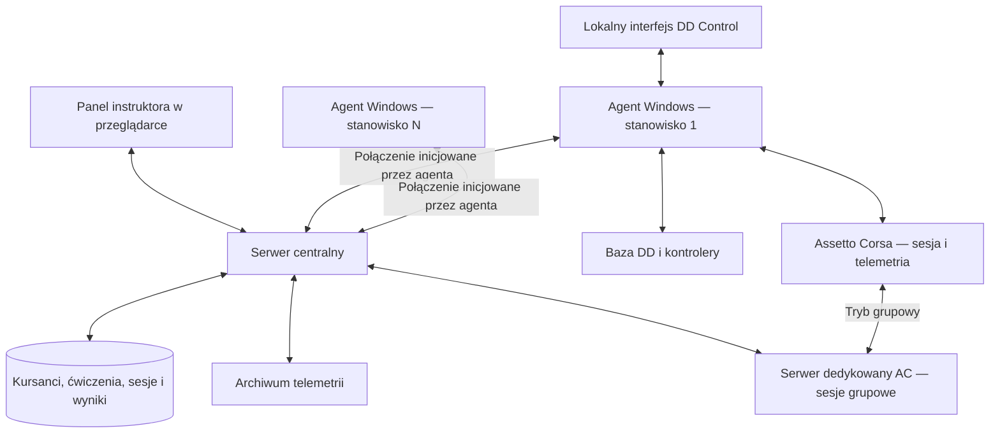

# Plan rozbudowy DD Control o system szkolenia kierowców

Data: 28 października 2026 r.

Status: historyczny dokument założeń sprzed implementacji. Aktualny stan MVP opisuje README repozytorium RaceCoach.

Uzupełnienie: [szczegółowa analiza integracji Assetto Corsa](analiza-integracji-assetto-corsa.md) obejmuje sterowanie zewnętrzne, pogodę runtime, źródła map torów oraz porównania sekcji i przejazdów referencyjnych.

## 1. Cel i założenia

Rozbudować obecny konfigurator DIY Direct Drive o system, w którym instruktor zarządza stanowiskami, tworzy indywidualne plany szkolenia dla zarejestrowanych kursantów, prowadzi ćwiczenia w Assetto Corsa, obserwuje przejazdy i analizuje postępy. Zarządzanie obejmuje konfigurację gry oraz obsługiwane ustawienia bazy DD, pedałów i kierownicy.

Wymagania użytkownika dla pierwszej wersji: zarówno niezależne sesje kursantów, jak i wspólne sesje na serwerze oraz plan treningu/szkolenia przypisany do konkretnego konta kursanta, rozpisany na konkretne sesje. W obu trybach wyniki i ocena trafiają do indywidualnej historii kursanta.

Założenie środowiska: stanowiska Windows w jednej sieci lokalnej i jeden panel instruktora. Liczba stanowisk pozostaje do ustalenia; demonstracja odbiorowa wymaga co najmniej dwóch.

Plan dotyczy oryginalnego Assetto Corsa. Integracja z Assetto Corsa Competizione wymaga osobnego adaptera.

## 2. Co już istnieje

| Obszar | Stan w lokalnym kodzie | Znaczenie dla rozbudowy |
| --- | --- | --- |
| DD Control | Python, PySide6/QML, profile lokalne, tryb demo | Lokalny interfejs konfiguracji i diagnostyki |
| Obsługa bazy | OpenFFBoard przez USB CDC i FFBeast przez USB HID | Ponowne wykorzystanie sterowników przez agenta |
| Warstwa niezależna od GUI | `FirmwareSpec`, `Field`, `Action`, `DeviceInfo`, `BaseLink` w `ddcontrol/core.py` | Fundament obsługi sprzętu w procesie agenta |
| Pedały i przyciski kierownicy | Odczyt kontrolerów przez WinMM oraz lokalne mapowanie | Brak zapisu konfiguracji firmware ESP32 |
| Firmware XDrive | Własny target STM32F405 i sterownik `MotorXDrive` | Lokalna obsługa FFB i parametrów silnika |
| System szkoleniowy | Brak serwera, agentów sieciowych, historii kursantów i integracji gry | Nowa część projektu |

Podstawa: [README DD Control](../../wheel-control/README.md), [warstwa sprzętowa](../../wheel-control/ddcontrol/core.py), [most GUI](../../wheel-control/ddcontrol/backend.py), [wejścia kontrolerów](../../wheel-control/ddcontrol/gamepads.py).

Dokumentacja aplikacji nadal wymaga walidacji na fizycznym sprzęcie; README targetu XDrive zawiera informację o braku uruchomienia na rzeczywistej płytce. Gotowość protokołów do pracy zdalnej należy potwierdzić pomiarami i testem stanowiska.

## 3. Podział systemu

**Panel instruktora:** konta kursantów, indywidualne plany szkolenia, lista stanowisk, kursant i ćwiczenie na stanowisku, status gry i sprzętu, zlecanie sesji indywidualnych i grupowych, podgląd danych, porównanie przejazdów, zatwierdzone profile sprzętu i notatki instruktora.

**Serwer centralny:** rejestr stanowisk, uwierzytelnianie i role, plany kursantów, wersje ćwiczeń i profili, obsługa poleceń, koordynacja sesji grupowych, historia oraz przechowywanie i udostępnianie wyników. Może działać na komputerze instruktora albo oddzielnym komputerze w LAN.

**Agent stanowiska:** działa w sesji użytkownika Windows, obsługuje sprzęt, przygotowuje i uruchamia sesję gry, odczytuje telemetrię, weryfikuje wykonanie poleceń i buforuje dane przy utracie sieci. W MVP może uruchamiać się po zalogowaniu użytkownika.

Pętla Force Feedback pozostaje lokalna między grą a firmware. Serwer przesyła ustawienia i polecenia administracyjne; opóźnienie sieci nie może uczestniczyć w sterowaniu momentem silnika.

## 4. Integracja z Assetto Corsa

### Telemetria

Agent odczytuje lokalne mapowania pamięci gry: `acpmf_physics`, `acpmf_graphics` i `acpmf_static`. Kod Content Managera pokazuje użycie przestrzeni `Local`. Własny agent zapewnia transmisję do centrali. [Implementacja odczytu](https://github.com/gro-ove/actools/blob/master/AcManager.Tools/SharedMemory/AcSharedMemory.cs).

Na początek pobierać gaz, hamulec, skręt, prędkość, bieg i obroty; rozszerzeniem mogą być przeciążenia, poślizg i dane opon. [Struktura physics](https://github.com/gro-ove/actools/blob/master/AcManager.Tools/SharedMemory/AcSharedPhysics.cs).

Czasy okrążeń, sektory, współrzędne i pozycja na torze służą do historii i porównania przejazdów. [Struktura graphics](https://github.com/gro-ove/actools/blob/master/AcManager.Tools/SharedMemory/AcSharedGraphics.cs).

Interpretację jednostek, znaku skrętu, stanu pauzy/replay i poprawności próbek należy sprawdzić na używanej wersji gry. Brak nowej próbki nie oznacza wartości zero. Odczyt gazu i hamulca z gry opisuje wejście po przetwarzaniu przez grę; pomiar rzeczywistej siły nacisku wymaga osobnych danych z pedałów.

### Przygotowanie ćwiczenia i uruchamianie

Content Manager jest alternatywnym launcherem i narzędziem konfiguracji. Jego kod zapisuje samochód, tor i layout, tryb sesji oraz warunki do `race.ini`. Pokazuje też cykl uruchomienia gry i pobrania wyniku. To materiał do budowy adaptera, a nie potwierdzenie publicznego API zarządzania Content Managerem. [Konfiguracja](https://github.com/gro-ove/actools/blob/master/AcTools/Processes/Game.Properties.cs), [cykl uruchomienia](https://github.com/gro-ove/actools/blob/master/AcTools/Processes/Game.cs).

W MVP ustawienia toru, samochodu i pogody obowiązują przy kolejnym uruchomieniu sesji. Adapter powinien serializować operacje startu, zachować kopię zmienianej konfiguracji i zapobiegać równoczesnemu nadpisaniu jej przez lokalny launcher. Dokładną metodę startu należy wybrać po próbie na docelowym Windows z zainstalowaną grą i Steam.

### Pogoda i mody

Podstawowe warunki sesji oraz dynamiczną pogodę traktować jako osobne możliwości. Weather FX jest funkcją Custom Shaders Patch; dostępność deszczu i konkretnych zmian zależy od zainstalowanego zestawu. Każde stanowisko raportuje wersję CSP i kontrolera pogody. Ćwiczenie wymaga sprawdzonej kombinacji, a panel pokazuje dostępne opcje. [CSP](https://acstuff.club/patch/), [strona autora CM](https://acstuff.club/app/).

Sterowanie pogodą w trakcie jazdy wymaga osobnej, zweryfikowanej integracji z wybranym kontrolerem. Dokumentacja Lua CSP jest dostarczana wraz z buildem w `extension/internal/lua-sdk`. [SDK autora](https://github.com/ac-custom-shaders-patch/acc-lua-sdk).

Konkretnym wariantem do próby jest alternatywny AssettoServer: dokumentuje zmianę pogody, deszczu, mokrości i przyczepności podczas działania, a SamplePlugin pokazuje dodawanie tras HTTP. Własny most do centrali wymaga implementacji; zgodność klientów i wpływ deszczu na fizykę należy potwierdzić. [Polecenia AssettoServer](https://assettoserver.org/docs/next/admin-commands/), [SamplePlugin](https://assettoserver.org/docs/next/plugins/SamplePlugin/).

### Wspólna sesja

Tryb grupowy wymaga serwera dedykowanego AC już w pierwszej wersji. Plugin UDP może przekazywać zdarzenia i obsługiwać wybrane polecenia sesji. Agent nadal zbiera lokalną telemetrię kursanta. [Definicja protokołu używana przez CM](https://github.com/gro-ove/actools/blob/master/AcManager.Tools/AcPlugins/Kunos/ACSProtocol.cs).

W projekcie przyjąć wspólny tor/layout, warunki i ramy czasowe dla uczestników jednej sesji grupowej. Dopuszczone samochody i pozostałe reguły określa scenariusz. Uczestnicy mogą mieć różne cele szkoleniowe, zatwierdzone profile sprzętu i kryteria oceny. Różne tory wymagają niezależnych sesji lub osobnych instancji serwera.

Centrala przygotowuje instancję serwera, sprawdza zgodność treści na stanowiskach, przypisuje kursantów do miejsc i zleca dołączenie agentom. Panel pokazuje gotowość każdego uczestnika. Brak gotowości jednego stanowiska wymaga jawnej decyzji instruktora o oczekiwaniu albo uruchomieniu gotowej części grupy. MVP obejmuje jeden zarządzany serwer grupowy LAN i ręczny dobór uczestników, ze wskazaniem zgodności ćwiczeń z ich planów.

## 5. Zarządzanie sprzętem

Jeden proces jest właścicielem połączeń COM/HID. Docelowo jest nim agent; lokalne GUI i panel centralny korzystają z jego usług. Przejściowo klient połączenia centralnego może działać wewnątrz DD Control i używać już istniejącego `BaseLink`.

Logikę wyboru bazy, profili i wejść należy wydzielić z `Backend(QObject)` do serwisu niezależnego od QML. Samo `BaseLink` już nie zależy od Qt.

Rozróżnić cztery typy konfiguracji:

1. **Konfiguracja stanowiska:** identyfikacja urządzeń, firmware, skalibrowane limity i możliwości.
2. **Profil sprzętu do ćwiczenia:** zatwierdzony zakres obrotu, ustawienia FFB i dopuszczalne limity.
3. **Konfiguracja wejść gry:** przypisanie osi/przycisków, odwrócenie i krzywe w Assetto Corsa.
4. **Ćwiczenie:** auto, tor, warunki, asysty, czas i kryteria oceny.

Obecny profil OpenFFBoard obejmuje wybrany zestaw pól FFB. Nie zawiera całej konfiguracji silnika, limitu prądu ani `axis.power`, więc wymaga rozszerzonego modelu przed centralnym wdrażaniem.

W obecnym targecie XDrive blokada końca zakresu korzysta z pełnego limitu prądu niezależnie od `axis.power`. Zatwierdzenie profilu dla kursanta musi zatem uwzględniać również konfigurację silnika i blokady. Źródło: `OpenFFBoard-XDrive/Firmware/Targets/F405RG_XDRIVE/README.md`, sekcja pierwszego uruchomienia.

Firmware pedałów i kierownicy wymaga kanału konfiguracyjnego, jeśli centrala ma zmieniać kalibrację, martwe strefy lub mapowanie zapisane w urządzeniu. Możliwe warianty do oceny: vendor HID, USB CDC lub charakterystyka GATT dla BLE. Sam odczyt kontrolera przez WinMM tego nie zapewnia.

Agent udostępnia wyłącznie parametry wykryte dla konkretnego urządzenia. Instruktor korzysta z zatwierdzonych profili; kalibracja silnika, autotest, DFU i parametry serwisowe należą do odrębnego trybu obsługi. Zmiany profilu wdrażać między przejazdami. Fizyczne zatrzymanie awaryjne działa lokalnie, niezależnie od sieci.

## 6. Polecenia i stan stanowiska

Stan połączenia z serwerem, połączenia ze sprzętem i aktywności gry raportować oddzielnie. Panel odróżnia dane aktualne od ostatnio znanych.

Każde polecenie zawiera co najmniej:

- `command_id`, `station_id` i typ operacji;
- identyfikator sesji szkoleniowej oraz oczekiwaną rewizję konfiguracji;
- czas wygaśnięcia i parametry operacji.

Cykl polecenia: `zlecone → przyjęte → wykonywane → potwierdzone / częściowe / odrzucone / błąd / wynik nieznany`.

Przyjęcie do kolejki nie oznacza wykonania. Zastosowanie profilu potwierdza odczyt ustawień z urządzenia i porównanie z żądaniem; rozpoczęcie sesji — wykrycie uruchomionej gry i oczekiwanego auta/toru. Pola, których nie można zweryfikować, mają jawny status.

Po ponownym połączeniu agent raportuje rzeczywisty stan i znane wyniki poleceń. Przedawnione komendy odrzuca, a identyfikatory już wykonanych zapamiętuje. Operacji takich jak kalibracja lub start gry nie powtarza automatycznie po niejednoznacznym timeoutcie. Utrata łącza zachowuje bieżący profil i lokalny zapis przejazdu.

Walidacja pól, uprawnień i stanu działa w agencie, również przy pominięciu GUI. Zdalne API nie powinno udostępniać dowolnej konsoli firmware ani poleceń powłoki.

## 7. Konto kursanta i indywidualny plan szkolenia

Kursant ma konto z rolą `Kursant` i trwały profil. Instruktor przypisuje go do stanowiska na czas zajęć. Zmiana stanowiska zachowuje plan, historię i postępy. Instruktor i obsługa serwisowa mają odrębne uprawnienia.

Rozdzielić program szkolenia, indywidualny plan oraz rzeczywiste próby:

| Pojęcie | Zawartość |
| --- | --- |
| Szablon programu | Wersjonowany zestaw etapów i proponowanych sesji, możliwy do wykorzystania dla wielu osób |
| Plan kursanta | Konkretny kursant, instruktor, cele ogólne i własna lista zaplanowanych sesji; można utworzyć bez szablonu |
| Zaplanowana sesja szkoleniowa | Kolejność, opcjonalny termin, cel, tryb indywidualny/grupowy, scenariusz, długość, profil sprzętu, kryteria i wymagania wstępne |
| Realizacja sesji symulatora | Faktyczne uruchomienie gry: czas, scenariusz, tryb i uczestnicy; w trybie grupowym wspólna instancja |
| Próba kursanta | Uczestnictwo konkretnej osoby w realizacji, stanowisko, telemetria, wynik, ocena i powiązanie z pozycją jej planu |

Jedna zaplanowana sesja może wymagać wielu prób. Każda próba zachowuje własny wynik; powtórzenie nie nadpisuje historii. Przełożenie terminu albo zmiana planu nie zmienia już wykonanych prób. Zmiany celów i kryteriów są wersjonowane.

Przykładowy plan kursanta:

| Sesja | Tryb | Cel | Przykładowe kryterium |
| --- | --- | --- | --- |
| 1 | Indywidualny | Powtarzalne hamowanie w wyznaczonej strefie | Trzy kolejne próby w zakresie zaakceptowanym przez instruktora |
| 2 | Indywidualny | Linia przejazdu i płynność gazu | Porównanie wybranych zakrętów z wzorcem i ocena instruktora |
| 3 | Grupowy | Jazda za instruktorem na wspólnym torze | Ukończenie ćwiczenia i realizacja indywidualnych celów |
| 4 | Grupowy lub indywidualny | Sprawdzenie postępów | Porównanie z próbą początkową przy zgodnych warunkach |

Kryteria są konfigurowalne, powiązane z dostępnymi danymi i oceną instruktora. Sam najlepszy czas okrążenia nie wystarcza do oceny całego ćwiczenia.

Proponowany status pozycji planu: `zaplanowana`, `gotowa`, `w trakcie`, `do powtórzenia`, `zaliczona`, `pominięta`. Status próby i status pozycji planu to osobne informacje: przerwana próba nie oznacza automatycznie niezaliczenia. Zaliczenie w MVP zatwierdza instruktor na podstawie metryk i notatki.

W trybie grupowym jedna realizacja ma wielu uczestników, ale każda osoba realizuje wskazaną pozycję własnego planu. Sesja grupowa może więc jednocześnie służyć różnym celom kilku kursantów. Zapisuje się zgodność wspólnego scenariusza z wymaganiami ich planów oraz indywidualne wyniki; wynik grupy nie zastępuje oceny osoby.

## 8. Dane szkoleniowe i analiza

Minimalny model: `User`, `TraineeProfile`, `Station`, `TrainingPlanRevision`, `TraineePlan`, `PlannedSessionRevision`, `ExerciseRevision`, `HardwareProfileRevision`, `SimulatorSession`, `SessionParticipant`, `Attempt`, `Command`, `Lap`, `TelemetryChunk` oraz notatki instruktora. Szczegóły tabel i relacji ustalić w projekcie bazy.

Każda próba kursanta przechowuje migawkę faktycznie użytych ustawień: osobę, stanowisko, auto, tor/layout i wersje treści, warunki, asysty, profil sprzętu, wersje gry/modów/adaptera oraz metadane próbkowania. Wspólna realizacja sesji przechowuje dodatkowo konfigurację serwera. Edycja ćwiczenia tworzy nową rewizję; historyczne wyniki zachowują własny kontekst. Kryteria oceny określają także wymaganą kompletność danych i sposób traktowania nieważnych okrążeń.

Próbki mają numer kolejny, czas lokalny monotoniczny, identyfikator sesji i wskaźnik jakości. Czas UTC służy do historii zdarzeń między stanowiskami; czas monotoniczny do odstępów wewnątrz przejazdu. Bufor ma określony limit miejsca, a niepełne nagranie jest oznaczone.

Roboczy cel techniczny do pomiaru na docelowym PC: archiwum 50–100 próbek/s dla podstawowych kanałów, podgląd panelu 5–10 aktualizacji/s. To proponowane częstotliwości własnego systemu, nie gwarancja częstotliwości odświeżania gry. Rejestrować nowe pakiety zamiast traktować wielokrotny odczyt tego samego pakietu jako nowe dane.

Pierwsze analizy:

- czasy i powtarzalność ważnych okrążeń;
- punkty rozpoczęcia hamowania, przebieg zwalniania hamulca i dodawania gazu;
- wykresy prędkości i skrętu względem pozycji na trasie;
- porównanie z przejazdem instruktora lub wcześniejszym przejazdem kursanta;
- oznaczenia wyjazdów poza tor i innych zdarzeń, o ile potwierdza je wybrane źródło.

Porównania powinny używać zgodnego scenariusza oraz wspólnej osi pozycji/dystansu, z obsługą startu i końca okrążenia. Trasy punkt–punkt wymagają osobnego sposobu segmentacji. Kryteria ważności i metryki należy uzgodnić z instruktorem; automatyczna ocena techniki jest kolejnym etapem.

Panel raportu ma pokazywać mapę toru z własnymi, wersjonowanymi sekcjami szkoleniowymi. Każda sekcja przedstawia lokalny zysk/stratę względem wskazanego przejazdu i pozwala przejść do zsynchronizowanych wykresów prędkości, gazu, hamulca i skrętu. Osobno prezentować deltę skumulowaną. Źródłem mapy może być lokalna mapa toru z transformacją, dane AI albo zapis współrzędnych; geometria i sekcje są przypisane do konkretnego layoutu i wersji toru. Wzorzec wymaga pełnego nagrania telemetrii.

## 9. Proponowane technologie

| Warstwa | Propozycja | Uzasadnienie |
| --- | --- | --- |
| Agent | Python i istniejące sterowniki DD Control | Największe wykorzystanie aktualnego kodu i symulatorów |
| Serwer | FastAPI, REST oraz WebSocket | Jeden backend dla panelu, agentów, poleceń i podglądu |
| Panel | TypeScript/React | Widok wielu stanowisk i wykresy dostępne w przeglądarce |
| Metadane | PostgreSQL | Wspólna historia kursantów, sesji, rewizji i poleceń |
| Telemetria | Pliki z porcjami danych i indeksy w bazie | Ograniczenie liczby zapisów pojedynczych próbek do bazy |
| Bufor stanowiska | SQLite i lokalne pliki nagrań | Wznawianie wysyłki po przerwie połączenia |

Jest to rekomendacja projektowa, a nie wymóg integracji z AC. Na start wystarczy jeden backend i jedna centralna baza. Osobny broker, mikroserwisy i specjalistyczna baza szeregów czasowych nie są potrzebne do pierwszego wdrożenia.

Agent inicjuje uwierzytelnione połączenie z centralą. Parowanie stanowiska nadaje mu własną tożsamość; panel ma role instruktora i serwisanta. Połączenie szyfrować, a zmiany konfiguracji zapisywać w dzienniku. Kolejki sterowania i telemetrii mają osobne priorytety, aby wysyłka archiwum nie blokowała poleceń.

## 10. Kolejność realizacji i kryteria odbioru

| Etap | Zakres | Kryterium odbioru |
| --- | --- | --- |
| 0. Próba integracyjna | Windows, AC, odczyt pamięci, start lokalny, serwer AC i dołączenie dwóch klientów, rzeczywista baza | Działają oba tryby, zapis danych i potwierdzona zmiana ustawienia sprzętu |
| 1. Agent i centrala | Wydzielenie serwisu stanowiska, parowanie, heartbeat, statusy, polecenia | Dwa stanowiska demo widoczne w panelu; przerwa sieci i reconnect nie powtarzają operacji |
| 2. Kursanci i plany | Konta i role, plan osoby, konkretne sesje i rewizje ćwiczeń, przypisanie stanowiska | Instruktor tworzy dwa różne plany; zmiana stanowiska zachowuje plan i historię |
| 3. Prowadzenie zajęć | Katalog treści, start sesji indywidualnej, koordynacja serwera grupowego i uczestników | Działają niezależne ćwiczenia i wspólna jazda; próby grupowe trafiają do właściwych planów osób |
| 4. Podgląd i ocena | Telemetria, okrążenia, bufor offline, raporty, porównania, zaliczenie i powtórzenia | Powtórka zachowuje poprzedni wynik; instruktor widzi postęp planu oraz kompletność danych |
| 5. Profile DD | Lista możliwości, zatwierdzone profile, odczyt zwrotny, blokady stanu | Panel rozróżnia profil żądany i odczytany; GUI i agent współdzielą jednego właściciela USB |
| 6. Rozszerzenia | Konfiguracja ESP32, dynamiczna pogoda podczas jazdy, HUD | Osobne kryteria dla każdego adaptera na przypiętych wersjach |

**Pierwsza użyteczna wersja:** instruktor rejestruje dwóch kursantów, układa dla nich plany z konkretnymi sesjami, przypisuje stanowiska, prowadzi zajęcia indywidualne i grupowe, stosuje zatwierdzone profile DD, widzi telemetrię i czasy, porównuje próby oraz zalicza lub ponawia pozycje planu. Łączy to etapy 0–5 w ograniczonym zakresie: jeden zweryfikowany wariant firmware i konfiguracji gry oraz wybrany katalog scenariuszy. Oba tryby i plany kursantów są częścią MVP.

Przed szerszym wdrożeniem wykonać test na dwóch rzeczywistych stanowiskach, w tym odłączenie sieci/USB, restart agenta, brak toru lub auta, zajęty port COM, niezgodny firmware, częściowe zastosowanie profilu oraz przerwanie zapisu telemetrii. Tryb demo i istniejące symulatory wspierają rozwój, a walidację gry i sprzętu wykonać na Windows.

## 11. Granice tej analizy

Stan lokalny sprawdzono w `wheel-control` i `OpenFFBoard-XDrive`. Wskazanego repozytorium bazowego [sim-racing-setup-DIY](https://github.com/Camildo7/sim-racing-setup-DIY) nie udało się odczytać podczas analizy, więc nie potwierdzono jego aktualnej zawartości.

Możliwości integracji AC oceniono na podstawie kodu autorów CM/CSP. Wybranie sposobu uruchamiania, jednostek telemetrii i obsługi pogody wymaga próby na docelowym stanowisku. Nie uruchamiano gry ani fizycznego sprzętu i nie wprowadzano zmian do kodu wykonawczego.
